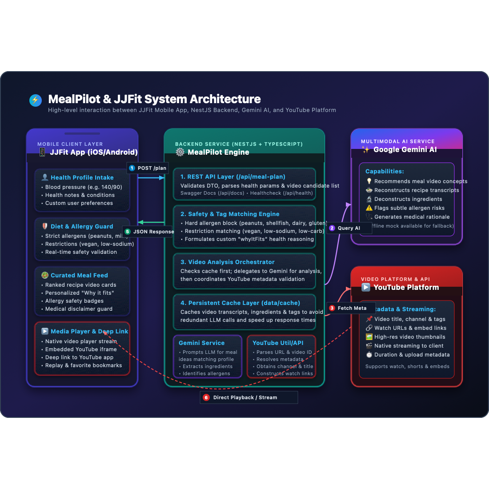
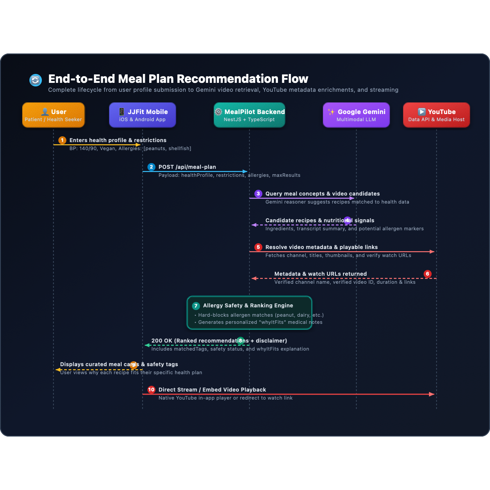

# JJFit & MealPilot Architecture Overview

This document provides a high-level architectural overview of the **JJFit** mobile application ecosystem integrated with the **MealPilot** backend service.

---

## 1. High-Level Architecture Diagram

*The JJFit mobile app sends a health-aware meal-plan request to the MealPilot backend. The backend coordinates Gemini analysis, YouTube metadata and links, allergy filtering, and cached results before returning ranked recommendations.*

---

## 2. Sequence Diagram (End-to-End User Flow)

*The numbered flow shows the request lifecycle: JJFit captures the profile, the backend asks Gemini for analysis, enriches candidates with YouTube metadata and links, applies safety rules, and returns a curated response for playback in the app.*

---

## 3. Core Component Breakdown

### 3.1 Frontend: **JJFit Mobile App** (iOS / Android)
* **User Health & Dietary Onboarding**: Collects health conditions (e.g., hypertension, diabetes), biometric data (e.g., blood pressure), dietary preferences, and strict allergies.
* **Meal Plan Feed**: Displays tailored meal recommendations, nutritional breakdowns, and personalized explanations (*"Why it fits"*).
* **Safety Badges**: Visual indicator of allergy safety verdicts (`safe`, `unsafe`, `needs-review`).
* **Media Player**: Native embedded player or deep-link redirect to YouTube watch URLs.

### 3.2 Backend: **MealPilot Service** (NestJS)
* **REST API Gateway**: Exposes secure endpoints (such as `POST /api/meal-plan` and `GET /api/health`).
* **Gemini Service**:
  * Leverages Gemini to discover recipe/meal video suggestions suited to complex health profiles.
  * Extracts reconstructed transcripts, ingredients, nutrition signals, and potential allergen presence.
* **YouTube Service / Util**:
  * Resolves and extracts canonical video IDs from various URL formats (`watch`, `youtu.be`, `shorts`, `embed`).
  * Enriches video candidates with author/channel details and valid playback URLs.
* **Safety & Filtering Engine**:
  * **Allergy Safeguard**: Enforces hard-blocking when ingredients or transcripts conflict with user allergies.
  * **Dietary Tag Matching**: Validates adherence to restrictions like `low-sodium`, `gluten-free`, `vegan`, or `low-carb`.
* **Caching Layer**:
  * Persists video analyses locally or in a fast key-value cache to minimize external latency and API costs.

### 3.3 External Providers
* **Google Gemini API**: Advanced LLM for nutritional reasoning, recipe deconstruction, and video-to-health alignment.
* **YouTube**: Video hosting platform providing video metadata and streaming playback endpoints.
